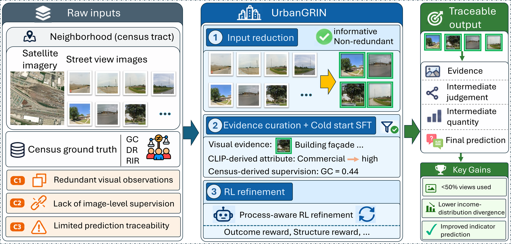

# UrbanGRIN

This is the repo for paper **UrbanGRIN: Reinforcing Multimodal Large Language Models for Evidence-Grounded Urban Inequality Estimation**.

UrbanGRIN estimates three tract-level inequality indicators from one satellite image and a set of street view images: the Gini coefficient (GC), the dominant race (DR), and the Black/White income ratio (RIR). 

The repo contains:
1. Supplementary material: Sup_Material_ICDE2027_UrbanGRIN.pdf 
2. dataset examples
3. UrbanGRIN_framwork (the environments and scripts for running codes).